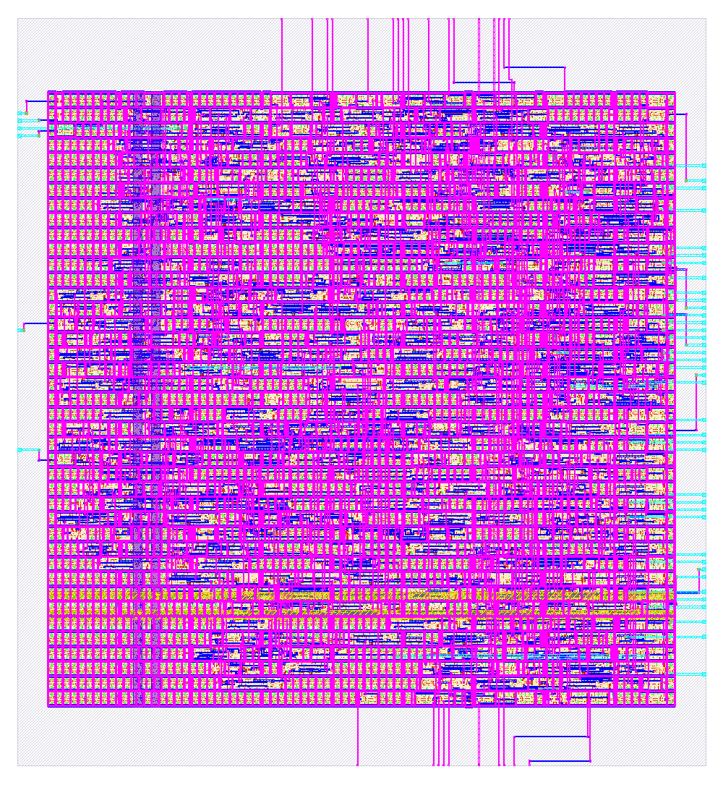

# Proyek IC Jam Digital 6-Digit (`jam_digital_top` — RTL hingga Sky130 GDSII)

Desain ASIC *end-to-end* untuk **Jam Digital 6-Digit (`HH:MM:SS`)** menggunakan **Verilog-2001** hingga layout fisik **GDSII** pada PDK **SkyWater 130nm (`sky130A` / `sky130_fd_sc_hd`)** dengan alur open-source (*Verilator*, *Icarus Verilog*, *cocotb*, *Yosys*, *LibreLane v3.0.17*, *OpenROAD*, *Magic*, *Netgen*, *KLayout*).



---

## 1. Ringkasan Spesifikasi & Hasil Teruku

- **Format Waktu**: `HH:MM:SS` dalam BCD (6 digit):
  - **Detik (`sec`)**: `00` s.d. `59`
  - **Menit (`min`)**: `00` s.d. `59`
  - **Jam (`hour`)**: `00` s.d. `11` (`11:59:59 -> 00:00:00`)
- **Fitur Utama**:
  - Single clock domain **`clk`** (**50 MHz**, periode `20.0 ns`), reset asinkron aktif-rendah **`rst_n`**.
  - Indikator **`rollover_pulse_o`** (pulsa 1 siklus saat `11 -> 00`) dan **`am_pm_o`** (toggle tiap rollover 12 jam).
  - *Synchronous load* (`load_en_i`) dengan **BCD clamping** otomatis agar nilai ilegal tidak masuk ke counter.
  - Tombol tambah manual (`inc_sec_i`, `inc_min_i`, `inc_hour_i`) dilengkapi **2-FF synchronizer + rising-edge detector** (latensi 3 siklus clock, bebas bounce/double-increment).
  - **Mode Uji Cepat (`fast_mode_i`)** untuk melewati prescaler 50.000.000 siklus saat verifikasi *exhaustive* 43.200 detik.
  - Driver display **7-segmen termultipleks 6 digit** (`seg_o[6:0]` aktif-tinggi `{g..a}`, `digit_sel_o[5:0]` one-hot) teregister bebas glitch.

### Ringkasan Hasil Verifikasi & Physical Design Signoff

| Tahap | Tool | Hasil Terukur |
| :--- | :--- | :--- |
| **Static Lint** | Verilator `5.044` (`--lint-only -Wall`) | **PASS** — `0` error, `0` warning |
| **Simulasi RTL** | Icarus Verilog `12.0` (`-g2012 -Wall`) | **PASS** — `43.235` checks, `0` error (termasuk sweep **43.200 detik**) |
| **Python Golden Model** | `cocotb 2.1.0` + Icarus `12.0` | **PASS** — `3/3` test suite lulus |
| **Sintesis Pre-P&R** | Yosys `0.62` (`sky130_fd_sc_hd__tt_025C_1v80`) | **PASS** — `0` latch, area `4.331,65 µm²` |
| **Post-P&R Sky130 GLS** | Icarus `12.0` (`-DFUNCTIONAL -DUNIT_DELAY=#1`) | **PASS** — `43.229` checks, `0` error pada netlist hasil P&R |
| **Geometri & Utilisasi** | LibreLane v3.0.17 / OpenROAD | Die `125,25 × 135,97 µm` (`17.030,2 µm²`), Core `12.722,2 µm²`, Utilisasi `57,34%`, `2.375` total instance (`768` sel aktif) |
| **Multi-Corner STA** | OpenSTA (9 PVT corner @ `20,0 ns`) | **0 Setup Violation**, **0 Hold Violation**; Worst Setup `+8,934 ns` (`Fmax` chip `90,37 MHz`, `r2r` `161,31 MHz`) |
| **Daya & IR-Drop** | OpenROAD (`nom_tt_025C_1v80`, 50 MHz) | Total Power **`823,15 µW`**, Worst IR Drop **`0,578 mV`** |
| **Signoff Fisik** | Magic / KLayout / Netgen | **Magic DRC = 0**, **KLayout DRC = 0**, **XOR = 0**, **LVS = 0**, **Antenna = 0** |

---

## 2. Panduan Lengkap Struktur Folder & Kegunaan Setiap File

Setiap subfolder di repositori ini juga dilengkapi `README.md` masing-masing agar mudah dibaca langsung saat menjelajah di GitHub.

```text
Jam_Digital/
├── .gitignore                        # Pengecualian file sementara P&R, biner .vvp, & cache Python
├── README.md                         # Panduan utama proyek (file ini)
├── docs/                             # Dokumentasi arsitektur, laporan uji, laporan P&R, & gambar layout
├── rtl/                              # Kode sumber Verilog-2001 sintetisabel (7 modul)
├── tb/                               # Testbench verifikasi (Verilog RTL, cocotb Python, & Sky130 GLS)
├── sim/                              # Filelist simulasi & hasil log/waveform (.vcd)
├── synth/                            # Skrip & laporan sintesis Yosys standalone
├── pnr/                              # Konfigurasi LibreLane & hasil akhir layout GDSII/signoff
└── scripts/                          # Skrip otomasi bash untuk menjalankan seluruh alur EDA
```

### Root & [`docs/`](docs/README.md) — Dokumentasi & Visualisasi

| File | Isi & Kegunaan |
| :--- | :--- |
| `.gitignore` | Mengabaikan direktori langkah perantara LibreLane (`pnr/runs/*/[0-9][0-9]-*/`, `tmp/`), biner kompilasi `*.vvp`, `cocotb_build/`, dan `__pycache__/` sambil tetap menyimpan artefak signoff akhir (`final/`). |
| `README.md` | Indeks proyek, panduan lengkap tiap folder/file, dan instruksi menjalankan alur dari awal hingga akhir. |
| `docs/README.md` | Indeks singkat dokumen di dalam folder `docs/`. |
| `docs/01_spec_architecture.md` | Spesifikasi lengkap: aturan hitungan `00:00:00–11:59:59`, diagram blok Mermaid, tabel pinout 72-pin `jam_digital_top`, aturan clamping BCD, dan latensi sinkronizer. |
| `docs/02_verification_report.md` | Laporan hasil Verilator lint, simulasi RTL (43.235 checks), cocotb, Post-P&R GLS (43.229 checks), matriks TC1–TC7, dan perintah GTKWave. |
| `docs/03_physical_design_report.md` | Analisis mendalam P&R LibreLane: geometri die/core, komposisi sel, wirelength & via per layer, tabel STA 9-corner, Fmax, power, IR-drop, dan checklist DRC/LVS. |
| `docs/layout_render.png` | Gambar render 2D layout GDSII akhir hasil KLayout untuk inspeksi visual cepat. |

### [`rtl/`](rtl/README.md) — Desain Hardware Verilog-2001

| File | Isi & Kegunaan |
| :--- | :--- |
| `rtl/README.md` | Penjelasan hierarki modul, konvensi clock/reset, dan detail desain RTL. |
| `rtl/clock_divider.v` | Prescaler sinkron `50 MHz -> 1 Hz` (`tick_1hz_o`), `tick_scan_o` untuk scan display, serta bypass `fast_mode_i`. |
| `rtl/edge_pulse_sync.v` | Sinkronizer 2-FF + detektor *rising-edge* 1 siklus (latensi 3 siklus clock) untuk input tombol asinkron. |
| `rtl/bcd_mod60_counter.v` | Counter BCD 2-digit `00..59` (dipakai untuk detik dan menit) dengan *synchronous clamped load* dan sinyal carry `is_max_o`. |
| `rtl/bcd_mod12_counter.v` | Counter BCD 2-digit `00..11` (jam) dengan *clamped load*, toggle `am_pm_o`, dan `rollover_pulse_o` saat `11 -> 00`. |
| `rtl/bcd_to_7seg.v` | Dekoder kombinasional BCD (0–9) ke 7-segmen aktif-tinggi `{g, f, e, d, c, b, a}` bebas latch. |
| `rtl/seven_seg_mux6.v` | Time-multiplexer 6 digit (`sec_ones` s.d. `hour_tens`) dengan keluaran `seg_o` & `digit_sel_o` teregister bebas glitch. |
| `rtl/jam_digital_top.v` | Modul *top-level* (72 pin) yang menghubungkan prescaler, sinkronizer tombol, counter detik/menit/jam, dan driver 7-segmen. |

### [`tb/`](tb/README.md) — Testbench Verifikasi

| File | Isi & Kegunaan |
| :--- | :--- |
| `tb/README.md` | Panduan testbench dan cakupan kasus uji TC1–TC7. |
| `tb/tb_jam_digital_top.v` | Testbench RTL *self-checking* (`iverilog`) untuk reset, prescaler 1 Hz, pause, semua batas rollover, **sweep penuh 43.200 detik**, load/clamp, tombol manual, dan 7-segmen. |
| `tb/test_jam_digital_cocotb.py` | Suite verifikasi Python **cocotb 2.1.0** membandingkan perilaku DUT terhadap model referensi Python. |
| `tb/tb_jam_digital_gls.v` | Testbench *Post-P&R Gate-Level Simulation* (GLS) yang menguji langsung netlist Sky130 hasil P&R (`final/nl/jam_digital_top.nl.v`) termasuk sweep **43.200 detik**. |

### [`sim/`](sim/README.md) — Filelist & Hasil Simulasi

| File | Isi & Kegunaan |
| :--- | :--- |
| `sim/README.md` | Penjelasan filelist, log simulasi, dan cara membuka waveform di GTKWave. |
| `sim/filelist.f` | Daftar urut 7 file RTL di `rtl/` untuk kompilasi `iverilog`. |
| `sim/results/compile.log` | Log kompilasi Icarus Verilog untuk simulasi RTL. |
| `sim/results/rtl_sim.log` | Log hasil simulasi RTL (`43.235` checks, `0` errors, `[TB_INFO] Simulation Finished!`). |
| `sim/results/jam_digital_rtl.vcd` | File waveform VCD hasil simulasi RTL (siap dibuka dengan GTKWave). |
| `sim/results/cocotb.log` | Log hasil eksekusi suite Python cocotb (`TESTS=3 PASS=3`). |
| `sim/results/cocotb_results.xml` | Hasil uji cocotb dalam format JUnit XML. |
| `sim/results/gls_compile.log` | Log kompilasi Gate-Level Simulation dengan model sel `sky130_fd_sc_hd`. |
| `sim/results/gls_sim.log` | Log hasil Sky130 Post-P&R GLS (`43.229` checks, `0` errors). |
| `sim/results/jam_digital_gls.vcd` | File waveform VCD hasil simulasi gate-level Sky130. |

### [`synth/`](synth/README.md) — Sintesis Yosys Standalone

| File | Isi & Kegunaan |
| :--- | :--- |
| `synth/README.md` | Penjelasan alur sintesis Yosys standalone dan hasilnya. |
| `synth/synth_yosys.ys` | Skrip Yosys untuk membaca RTL, memeriksa hierarki/latch (`check -assert`), dan memetakan ke `sky130_fd_sc_hd__tt_025C_1v80.lib`. |
| `synth/yosys_run.log` | Log penuh proses sintesis Yosys termasuk statistik sel per modul. |
| `synth/yosys_synth_report.md` | Ringkasan laporan sintesis Yosys (total area `4.331,65 µm²`, `93` flip-flop, `0` latch). |
| `synth/jam_digital_top_yosys.v` | Netlist gate-level hasil mapping Yosys standalone (pre-P&R). |

### [`pnr/`](pnr/README.md) — Physical Design RTL-to-GDSII (`LibreLane`)

| File / Folder | Isi & Kegunaan |
| :--- | :--- |
| `pnr/README.md` | Penjelasan konfigurasi P&R dan rincian seluruh sub-folder keluaran di `final/`. |
| `pnr/config.json` | Konfigurasi utama LibreLane (`DESIGN_NAME`, `VERILOG_FILES`, `CLOCK_PERIOD=20.0`, `FP_CORE_UTIL=40`, `PL_TARGET_DENSITY_PCT=55`, `RSZ_CORNERS`). |
| `pnr/runs/jam_digital_sky130/final/gds/jam_digital_top.gds` | Layout fisik GDSII final hasil Magic streamout (siap inspeksi/integrasi). |
| `pnr/runs/jam_digital_sky130/final/klayout_gds/jam_digital_top.klayout.gds` | Layout fisik GDSII final versi KLayout streamout (telah terverifikasi `0` XOR diff). |
| `pnr/runs/jam_digital_sky130/final/nl/jam_digital_top.nl.v` | Netlist Verilog post-P&R (tanpa pin power) untuk Gate-Level Simulation (`tb_jam_digital_gls.v`). |
| `pnr/runs/jam_digital_sky130/final/pnl/jam_digital_top.pnl.v` | Netlist Verilog post-P&R lengkap dengan pin power (`VPWR`/`VGND`) untuk LVS/integrasi chip. |
| `pnr/runs/jam_digital_sky130/final/def/`, `lef/`, `odb/` | File DEF, macro LEF, dan database OpenROAD untuk integrasi *hierarchical* atau analisis lanjutan. |
| `pnr/runs/jam_digital_sky130/final/spef/`, `sdf/`, `sdc/`, `lib/` | Ekstraksi parasitik RC (`SPEF`), timing delay (`SDF`), constraint (`SDC`), dan model timing (`LIB`) multi-corner. |
| `pnr/runs/jam_digital_sky130/final/mag/`, `mag_gds/`, `spice/` | View Magic, ekstraksi SPICE hasil layout untuk Netgen LVS. |
| `pnr/runs/jam_digital_sky130/final/render/jam_digital_top.png` | Render PNG asli hasil KLayout di tahap akhir P&R. |
| `pnr/runs/jam_digital_sky130/final/metrics.json` & `metrics.csv` | Rekap seluruh metrik numerik signoff (area, timing, skew, power, IR-drop, DRC, LVS). |

### [`scripts/`](scripts/README.md) — Skrip Otomasi Alur Kerja

| File | Urutan | Tool | Kegunaan |
| :--- | :---: | :--- | :--- |
| `scripts/README.md` | - | - | Panduan cepat daftar skrip dan prasyarat `PATH`. |
| `scripts/run_lint.sh` | 1 | Verilator | Memeriksa sintaks & aturan lint ketat (`--lint-only -Wall`) pada seluruh RTL. |
| `scripts/run_rtl_sim.sh` | 2 | Icarus Verilog | Mengompilasi & menjalankan `tb_jam_digital_top.v`, menghasilkan log & `jam_digital_rtl.vcd`. |
| `scripts/run_cocotb.sh` | 3 | Python `cocotb` | Menjalankan verifikasi berbasis Python golden model (`test_jam_digital_cocotb.py`). |
| `scripts/run_yosys.sh` | 4 | Yosys | Menjalankan sintesis & check latch/struktur ke sel Sky130 TT. |
| `scripts/run_pnr_librelane.sh` | 5 | LibreLane | Menjalankan alur penuh 80 tahap RTL-to-GDSII (`config.json` -> `pnr/runs/jam_digital_sky130/final/`). |
| `scripts/run_gls.sh` | 6 | Icarus Verilog | Menguji netlist post-P&R (`final/nl/jam_digital_top.nl.v`) dengan `sky130_fd_sc_hd.v`. |
| `scripts/open_klayout.sh` | 7 | KLayout | Membuka layout akhir `jam_digital_top.gds` di KLayout beserta layer palette `sky130A.lyp`. |

---

## 3. Panduan Menjalankan dari Awal hingga Akhi

### A. Prasyarat Environment (WSL Ubuntu / IIC-OSIC)
Skrip bawaan dikonfigurasi untuk environment IC Design pada **WSL Ubuntu**:
- **Icarus Verilog** (`iverilog`, `vvp`) dan **GTKWave** (`gtkwave`) terpasang di sistem Ubuntu (`/usr/bin/`).
- **Python 3.12 IC venv** di `/home/yokemikal/eda/venvs/ic-env` (berisi `cocotb 2.1.0`, `pytest`, `klayout`).
- **LibreLane** di `/home/yokemikal/eda/tools/librelane` (via `nix-shell` yang menyediakan `verilator`, `yosys`, `openroad`, `magic`, `netgen`, `klayout`, `librelane`).
- **Sky130A PDK (`ciel`)** di `/home/yokemikal/.ciel/ciel/sky130/versions/8afc8346a57fe1ab7934ba5a6056ea8b43078e71/sky130A`.
- *(Catatan: Jika Anda membuka proyek di lokasi berbeda atau menggunakan container Docker `IIC-OSIC-TOOLS` di `/foss/designs/projects/Jam_Digital`, sesuaikan variabel `PROJ_DIR`, `LIBRELANE_DIR`, atau `SKY130_VERILOG` di bagian atas file `scripts/*.sh` dan `pnr/config.json`.)*

### B. Langkah Eksekusi Berurutan (Step-by-Step)

Masuk ke direktori proyek di terminal WSL Ubuntu dan pastikan semua skrip dapat dieksekusi:

```bash
cd /home/yokemikal/eda/designs/projects/Jam_Digital
chmod +x scripts/*.sh
```

#### Langkah 1 — Static Lint RTL (Verilator)
Memastikan tidak ada error lebar bit, sinyal tidak terpakai, atau konstruksi non-sintetisabel:
```bash
./scripts/run_lint.sh
```
**Output sukses**: `[LINT_PASS] Verilator --lint-only -Wall passed with 0 errors and 0 warnings.`

#### Langkah 2 — Simulasi Fungsional RTL (Icarus Verilog + Sweep 43.200 Detik)
Menguji seluruh fitur jam digital mulai dari reset, prescaler, pause, rollover `11:59:59 -> 00:00:00`, sweep penuh 12 jam, clamping BCD, tombol manual, hingga 7-segmen:
```bash
./scripts/run_rtl_sim.sh
```
**Output sukses**: `[TB_MONITOR] Total Checks=43235, Errors=0` dan `[RTL_SIM_PASS] All RTL checks passed cleanly.`

Untuk melihat gelombang sinyal (*waveform*) RTL di GTKWave:
```bash
gtkwave sim/results/jam_digital_rtl.vcd &
```

#### Langkah 3 — Verifikasi Golden Model Python (`cocotb`)
Memvalidasi DUT terhadap model referensi Python di `tb/test_jam_digital_cocotb.py`:
```bash
./scripts/run_cocotb.sh
```
**Output sukses**: `TESTS=3 PASS=3 FAIL=0 SKIP=0` dan `[COCOTB_PASS] cocotb suite completed.`

#### Langkah 4 — Sintesis Yosys Standalone (Cek Latch & Estimasi Area Pre-P&R)
Memastikan desain bebas latch dan dapat dipetakan ke library sel standar `sky130_fd_sc_hd`:
```bash
./scripts/run_yosys.sh
```
**Output sukses**: `[YOSYS_PASS] Yosys synthesis completed.` Hasil statistik tercatat di `synth/yosys_run.log` dan `synth/yosys_synth_report.md`.

#### Langkah 5 — Physical Design Lengkap RTL-to-GDSII (LibreLane v3.0.17)
Menjalankan 80 tahap penuh: Sintesis → Floorplan → PDN → Placement → CTS → Routing → RC Extraction → Multi-Corner STA → Magic/KLayout Streamout → DRC → LVS:
```bash
./scripts/run_pnr_librelane.sh
```
*(Durasi eksekusi sekitar ~1–2 menit. Parameter floorplan/timing dapat disesuaikan di `pnr/config.json`.)*
**Output sukses**: `Flow complete.` dan seluruh hasil signoff tersimpan di `pnr/runs/jam_digital_sky130/final/`.

#### Langkah 6 — Post-P&R Gate-Level Simulation (Sky130 Netlist)
Menguji ulang **netlist gerbang fisik hasil P&R** (`final/nl/jam_digital_top.nl.v`) lengkap dengan unit delay sel Sky130 (`-DFUNCTIONAL -DUNIT_DELAY=#1`) termasuk sweep penuh 43.200 detik:
```bash
./scripts/run_gls.sh
```
**Output sukses**: `[TB_MONITOR] GLS Total Checks=43229, Errors=0` dan `[GLS_PASS] Post-P&R Sky130 Gate-Level Simulation passed cleanly.`

Untuk melihat waveform simulasi gate-level di GTKWave:
```bash
gtkwave sim/results/jam_digital_gls.vcd &
```

#### Langkah 7 — Inspeksi & Analisis Layout Fisik GDSII
Buka layout akhir di **KLayout** dengan layer palette `sky130A`:
```bash
./scripts/open_klayout.sh
```
Atau tinjau metrik lengkap hasil P&R (timing 9 corner, power, IR-drop, DRC/LVS) langsung melalui dokumen [docs/03_physical_design_report.md](docs/03_physical_design_report.md) atau file mentah `pnr/runs/jam_digital_sky130/final/metrics.json`.

---

### C. Troubleshooting Singkat
- **`nix-shell: command not found`**: Skrip di `scripts/` sudah menambahkan `/nix/var/nix/profiles/default/bin` ke `PATH` secara otomatis. Jika menjalankan manual di terminal baru, jalankan `source ~/.bashrc` terlebih dahulu.
- **Simulasi 1 Hz lambat?** Prescaler 50 MHz membutuhkan 50 juta siklus per detik. Pada testbench, gunakan parameter override (contoh `CLK_FREQ_HZ=10`) atau aktifkan input `fast_mode_i=1` agar 1 detik dieksekusi setiap 1 siklus clock.
- **Tampilan GUI KLayout/GTKWave tidak muncul di Windows?** Pastikan menggunakan WSLg (bawaan Windows 11) atau jalankan di dalam container GUI **IIC-OSIC-TOOLS** (`ic-osic`), tempat proyek ini otomatis ter-mount di `/foss/designs/projects/Jam_Digital`.
