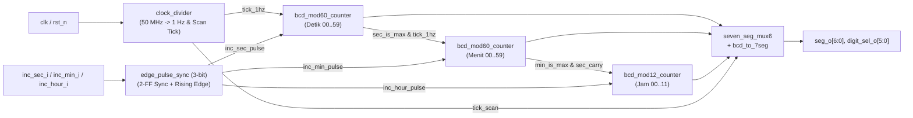

# Arsitektur & Spesifikasi IC Jam Digital 6-Digit (`jam_digital_top`)

## 1. Ringkasan Fungsional
`jam_digital_top` adalah desain IC digital sinkron 6-digit (`HH:MM:SS`) dalam format **BCD (Binary-Coded Decimal)** menggunakan teknologi target **SkyWater 130nm (`sky130_fd_sc_hd`)**.

- **Detik (`sec_tens_o`, `sec_ones_o`)**: Modulo-60 BCD, menghitung dari `00` hingga `59`, lalu wrap ke `00`.
- **Menit (`min_tens_o`, `min_ones_o`)**: Modulo-60 BCD, menghitung dari `00` hingga `59`, lalu wrap ke `00` saat menerima carry dari detik (`sec == 59` dan `tick_1hz`).
- **Jam (`hour_tens_o`, `hour_ones_o`)**: Modulo-12 BCD, menghitung dari `00` hingga `11` (`00, 01, ..., 09, 10, 11`), lalu wrap kembali ke `00` setelah `11:59:59 -> 00:00:00`.
- **Indikator Rollover & AM/PM**:
  - `rollover_pulse_o`: pulsa sinkron 1 siklus clock saat jam mengalami transisi `11 -> 00`.
  - `am_pm_o`: flip-flop toggle setiap kali terjadi rollover `11 -> 00` (`0` = paruh pertama 12 jam, `1` = paruh kedua 12 jam).
- **Keluaran Display 7-Segmen Termultipleks**: 6 digit (`seg_o[6:0]` aktif-tinggi `{g, f, e, d, c, b, a}` dan `digit_sel_o[5:0]` one-hot dari digit 0 = satuan detik sampai digit 5 = puluhan jam), teregister bebas glitch.

---

## 2. Clocking, Reset, dan Mode Uji (DFT)
- **Single Clock Domain**: Seluruh desain bekerja pada satu domain clock sinkron `clk` (nominal **50 MHz**, `CLOCK_PERIOD = 20.0 ns`). Tidak ada *gated clock* atau *derived clock*; pembagian waktu 1 Hz dan scan display diimplementasikan sebagai *synchronous clock enable pulse* (`tick_1hz`, `tick_scan`).
- **Asynchronous Active-Low Reset (`rst_n`)**: Ketika `rst_n == 0`, seluruh counter waktu di-reset ke `00:00:00`, `am_pm_o = 0`, `rollover_pulse_o = 0`, prescaler `0`, dan index mux display ke digit `0`.
- **Fast Test Mode (`fast_mode_i`)**: Membypass prescaler 50.000.000 siklus sehingga setiap siklus `clk` (saat `en_i == 1`) menghasilkan 1 `tick_1hz`. Fitur ini krusial untuk verifikasi *exhaustive* 43.200 detik (12 jam penuh) baik pada simulasi RTL maupun *Post-P&R Gate-Level Simulation (GLS)*.

---

## 3. Diagram Blok Arsitektur

---

## 4. Hierarki Modul RTL (`rtl/`)

| File | Modul | Fungsi |
| :--- | :--- | :--- |
| `rtl/jam_digital_top.v` | `jam_digital_top` | Top-level integrasi seluruh subsistem jam digital |
| `rtl/clock_divider.v` | `clock_divider` | Prescaler 50 MHz -> pulsa `tick_1hz_o` & `tick_scan_o` + `fast_mode_i` |
| `rtl/edge_pulse_sync.v` | `edge_pulse_sync` | Sinkronizer 2-FF + detektor rising-edge 1 siklus (latensi 3 siklus) |
| `rtl/bcd_mod60_counter.v` | `bcd_mod60_counter` | Counter BCD 00–59 dengan synchronous load & clamping |
| `rtl/bcd_mod12_counter.v` | `bcd_mod12_counter` | Counter BCD 00–11 dengan synchronous load, clamping, `am_pm_o`, `rollover_pulse_o` |
| `rtl/seven_seg_mux6.v` | `seven_seg_mux6` | Time-multiplexer 6-digit teregister bebas glitch |
| `rtl/bcd_to_7seg.v` | `bcd_to_7seg` | Dekoder kombinasional BCD ke 7-segmen aktif-tinggi `{g..a}` |

---

## 5. Spesifikasi Pinout Top-Level (`jam_digital_top`, Total 72 Pin)

| Port | Arah | Lebar | Deskripsi |
| :--- | :--- | :--- | :--- |
| `clk` | Input | 1 | Clock sistem utama (50 MHz nominal, periode 20 ns) |
| `rst_n` | Input | 1 | Reset asinkron aktif-rendah |
| `en_i` | Input | 1 | Enable hitungan (`1` = berjalan, `0` = pause) |
| `fast_mode_i` | Input | 1 | Mode uji cepat (`1` = 1 detik per siklus clock) |
| `load_en_i` | Input | 1 | Synchronous load enable (`1` = muat nilai waktu dari port `load_*`) |
| `inc_sec_i` | Input | 1 | Tombol manual tambah detik (disinkronisasi 2-FF + edge detect) |
| `inc_min_i` | Input | 1 | Tombol manual tambah menit (disinkronisasi 2-FF + edge detect) |
| `inc_hour_i` | Input | 1 | Tombol manual tambah jam (disinkronisasi 2-FF + edge detect) |
| `load_hour_tens_i` | Input | 4 | Input BCD puluhan jam untuk operasi load |
| `load_hour_ones_i` | Input | 4 | Input BCD satuan jam untuk operasi load |
| `load_min_tens_i` | Input | 4 | Input BCD puluhan menit untuk operasi load |
| `load_min_ones_i` | Input | 4 | Input BCD satuan menit untuk operasi load |
| `load_sec_tens_i` | Input | 4 | Input BCD puluhan detik untuk operasi load |
| `load_sec_ones_i` | Input | 4 | Input BCD satuan detik untuk operasi load |
| `hour_tens_o` | Output | 4 | Keluaran BCD puluhan jam (`0..1`) |
| `hour_ones_o` | Output | 4 | Keluaran BCD satuan jam (`0..9`) |
| `min_tens_o` | Output | 4 | Keluaran BCD puluhan menit (`0..5`) |
| `min_ones_o` | Output | 4 | Keluaran BCD satuan menit (`0..9`) |
| `sec_tens_o` | Output | 4 | Keluaran BCD puluhan detik (`0..5`) |
| `sec_ones_o` | Output | 4 | Keluaran BCD satuan detik (`0..9`) |
| `am_pm_o` | Output | 1 | Toggle setiap rollover `11:59:59 -> 00:00:00` |
| `rollover_pulse_o` | Output | 1 | Pulsa 1 siklus clock saat jam wrap dari `11` ke `00` |
| `tick_1hz_o` | Output | 1 | Pulsa 1 Hz keluaran prescaler (untuk monitoring/observasi) |
| `seg_o` | Output | 7 | Segmen 7-segment aktif-tinggi `{g, f, e, d, c, b, a}` |
| `digit_sel_o` | Output | 6 | Selektor anoda/digit one-hot (`[0]`=sec_ones .. `[5]`=hour_tens) |

---

## 6. Aturan Clamping BCD & Latensi Kontrol
- **Detik & Menit (`bcd_mod60_counter`)**: Jika `load_tens_i > 5`, di-clamp menjadi `5`. Jika `load_ones_i > 9`, di-clamp menjadi `9`. Contoh: `79` di-clamp menjadi `59`, `0F` menjadi `09`.
- **Jam (`bcd_mod12_counter`)**: Jika `load_tens_i >= 1`, puluhan menjadi `1` dan satuan di-clamp maksimal `1` (maks `11`). Jika `load_tens_i == 0`, satuan di-clamp maksimal `9` (maks `09`). Contoh: `19` menjadi `11`, `52` menjadi `11`, `0A` menjadi `09`.
- **Sinkronizer Tombol Manual (`edge_pulse_sync`)**: Perubahan `0 -> 1` pada `inc_sec_i`, `inc_min_i`, atau `inc_hour_i` melewati `sync_ff1 -> sync_ff2 -> prev_ff`, sehingga menghasilkan tepat satu pulsa `inc_*_pulse` dan memperbarui counter pada tepi naik clock ke-3 (latensi deterministik 3 siklus). Penekanan tombol manual pada detik/menit hanya memutar digit terkait (`59 -> 00`) tanpa memicu carry ke digit lebih tinggi.
