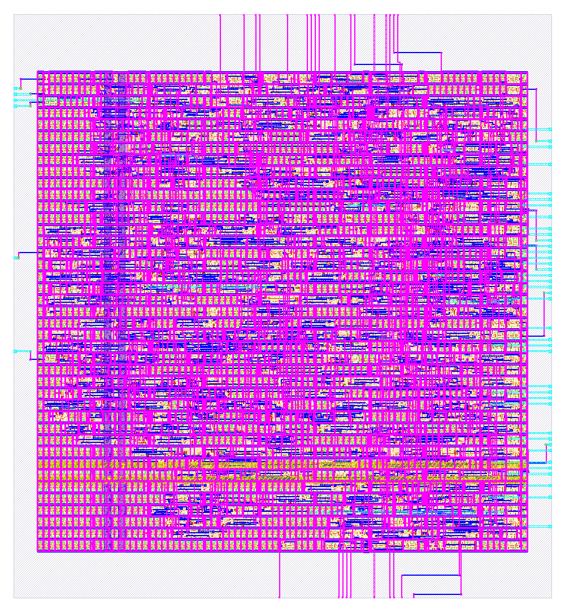

# Laporan Analisis Physical Design ASIC (`jam_digital_top` — Sky130A)

Dokumen ini merangkum hasil lengkap alur **RTL-to-GDSII** menggunakan **LibreLane v3.0.17** (Yosys + OpenROAD + Magic + Netgen + KLayout) dengan PDK **SkyWater 130nm (`sky130A` / `sky130_fd_sc_hd`)** pada run tag `jam_digital_sky130`.

---

## 1. Visualisasi Layout Akhi



*(Gambar hasil render langsung KLayout dari `pnr/runs/jam_digital_sky130/final/render/jam_digital_top.png`.)*

---

## 2. Geometri Die, Core, dan Utilisasi Standard Cell

| Parameter | Nilai Terukur |
| :--- | :--- |
| **PDK / Standard Cell Library** | `sky130A` / `sky130_fd_sc_hd` |
| **Die Bounding Box (`design__die__bbox`)** | `0.0 × 0.0` s.d. `125.25 × 135.97` µm |
| **Luas Die (`design__die__area`)** | **17.030,2 µm²** |
| **Core Bounding Box (`design__core__bbox`)** | `5.52 × 10.88` s.d. `119.60 × 122.40` µm (`114,08 × 111,52` µm) |
| **Luas Core (`design__core__area`)** | **12.722,2 µm²** |
| **Jumlah Row / Site (`unithd`)** | 41 rows / 10.168 sites |
| **Total Pin I/O (`floorplan__design__io`)** | 72 pin sinyal (`design__io` = 74 termasuk `VPWR`/`VGND`) |
| **Utilisasi Standard Cell (`design__instance__utilization`)** | **57,34%** (`7.294,5 µm²` stdcell aktif dari `12.722,2 µm²` core) |

### Komposisi Sel Fisik Post-P&R

| Kategori Sel | Jumlah Instance | Luas Area (µm²) |
| :--- | :---: | :---: |
| **Sequential Cells (Flip-Flop)** | 92 | 2.417,32 |
| **Multi-Input Combinational Cells** | 301 | 2.740,13 |
| **Inverters** | 16 | 60,06 |
| **Clock Buffers (CTS)** | 32 | 357,84 |
| **Timing Repair Buffers (Hold/Slew)** | 155 (53 hold buffers) | 1.503,94 |
| **Tap Cells** | 172 | 215,21 |
| **Filler Cells (Final Fill Insertion)** | 1.607 | 5.427,71 |
| **Total Semua Instance (`design__instance__count`)** | **2.375** | **12.722,2** |

---

## 3. Routing, Via, dan Clock Tree Synthesis (CTS)

- **Total Net Ter-routing (`route__net`)**: 613 net sinyal + 2 special net (`VPWR`, `VGND`)
- **Total Panjang Kawat (`route__wirelength`)**: **12.999 µm** (wire terpanjang: `329,12 µm`)
- **Total Via (`route__vias`)**: **4.034** single-cut vias:
  - `li1` (MCON/LI): `1.945`
  - `met1`: `2.024`
  - `met2`: `65`
  - `met3` / `met4`: `0` (sinyal lokal terselesaikan di `li1`–`met2`, menyisakan layer atas untuk PDN & pin I/O)
- **Detailed Routing DRC (`route__drc_errors`)**: **0** (konvergen dalam 3 iterasi: `158 -> 52 -> 42 -> 0`)
- **Antenna Violations (`route__antenna_violation__count`)**: **0** (0 diode antena dibutuhkan)

---

## 4. Analisis Static Timing Analysis (STA) Multi-Corne

Target clock: **`clk` @ 20,0 ns (50,0 MHz)**. Seluruh 9 PVT corner dievaluasi setelah *parasitic extraction* (OpenROAD RCX + OpenSTA).

| PVT Corner | Setup WS (ns) | Setup Reg2Reg WS (ns) | Hold WS (ns) | Worst Setup Skew (ns) | Worst Hold Skew (ns) | Setup / Hold Violations |
| :--- | :---: | :---: | :---: | :---: | :---: | :---: |
| **`nom_tt_025C_1v80`** (Typical 25 °C, 1,80 V) | `+12,4415` | `+16,8847` | `+0,3270` | `+0,2854` | `-0,3412` | **0 / 0** |
| **`nom_ss_100C_1v60`** (Slow-Slow 100 °C, 1,60 V) | `+8,9958` | `+13,8385` | `+0,8932` | `+0,3055` | `-0,4058` | **0 / 0** |
| **`nom_ff_n40C_1v95`** (Fast-Fast -40 °C, 1,95 V) | `+13,6648` | `+17,9764` | `+0,1164` | `+0,2772` | `-0,3136` | **0 / 0** |
| **`max_ss_100C_1v60`** (Worst Setup Corner) | **`+8,9341`** | **`+13,8007`** | `+0,9081` | `+0,3142` | `-0,4112` | **0 / 0** |
| **Worst Overall (Across All 9 Corners)** | **`+8,9341`** | **`+13,8007`** | **`+0,1132`** | `+0,2742` | `-0,3117` | **0 / 0** |

### Perhitungan Frekuensi Maksimum ($F_{\max}$)
- **Full-Chip I/O-Constrained $F_{\max}$ (Worst Corner `max_ss_100C_1v60`)**:
  $$F_{\max,\text{chip}} = \frac{1000}{20{,}0 - 8{,}9341} \approx \mathbf{90{,}37\text{ MHz}}$$
  *(Jalur kritis berada pada input `fast_mode_i` -> logika prescaler dengan default I/O external delay 4,0 ns.)*
- **Internal Register-to-Register $F_{\max}$ (Worst Corner `max_ss_100C_1v60`)**:
  $$F_{\max,\text{r2r}} = \frac{1000}{20{,}0 - 13{,}8007} \approx \mathbf{161{,}31\text{ MHz}}$$
- **Typical Corner (`nom_tt_025C_1v80`)**: $F_{\max,\text{chip}} \approx \mathbf{132{,}30\text{ MHz}}$, $F_{\max,\text{r2r}} \approx \mathbf{321{,}00\text{ MHz}}$.

---

## 5. Analisis Daya (Power) & IR-Drop (`nom_tt_025C_1v80`, 50 MHz)

| Komponen Daya | Nilai Terukur | Persentase |
| :--- | :---: | :---: |
| **Internal Power** | `526,93 µW` (`0,5269 mW`) | 64,01% |
| **Switching Power** | `296,22 µW` (`0,2962 mW`) | 35,99% |
| **Leakage Power** | `12,83 nW` (`0,0000128 mW`) | < 0,01% |
| **Total Power (`power__total`)** | **`823,15 µW` (`0,823 mW`)** | **100%** |

- **Power Grid (`VPWR` 1,80 V / `VGND` 0,00 V)**:
  - Worst IR Drop `VPWR`: **`0,576 mV`** (tegangan terendah `1,79942 V`)
  - Worst IR Drop `VGND`: **`0,578 mV`** (ground bounce maks `0,000578 V`)
  - Average IR Drop: **`0,185 mV`** (`0` pelanggaran power grid)

---

## 6. Checklist Signoff Manufaktur & Catatan Teknis

| Pemeriksaan Signoff | Hasil | Status |
| :--- | :--- | :---: |
| Verilator RTL Lint (`01-verilator-lint`) | `0` error, `0` warning, `0` latch | **PASS** |
| Yosys Unmapped / Synth Checks (`07–08`) | `0` unmapped cells, `0` check errors | **PASS** |
| Setup & Hold Timing (All 9 Corners) | `0` setup violations, `0` hold violations (`TNS = 0`) | **PASS** |
| Max Capacitance Violations (All 9 Corners) | `0` violations | **PASS** |
| Magic DRC (`64-magic-drc`) | `0` DRC errors, `0` illegal overlaps | **PASS** |
| KLayout DRC (`65-klayout-drc`) | `0` DRC errors | **PASS** |
| Magic vs KLayout GDS XOR (`62-klayout-xor`) | `0` XOR differences | **PASS** |
| Netgen LVS (`70-netgen-lvs`) | `0` device/net/pin/property mismatches | **PASS** |
| Antenna & Disconnected Pins (`46, 48`) | `0` antenna violations, `0` disconnected pins | **PASS** |
| Max Slew (`TT`/`FF`) / (`SS` 1,60 V 100 °C) | `0` di `TT` & `FF`; `30` warning slew ringan (limit `0,75 ns`, terukur `0,75–0,96 ns`) pada buffer `fanout*` di corner `SS` | **CATATAN** |
| Max Fanout (`clkbuf_0_clk/X`) | `1` fanout warning (`16` sink vs batas default `10` pada root buffer CTS `clkbuf_16`) | **CATATAN** |

> **Catatan Rekayasa**: 30 pelanggaran slew ringan di sudut lambat `SS` (`1,60 V, 100 °C`) dan 1 fanout warning pada root buffer CTS tidak menyebabkan pelanggaran setup/hold (margin setup masih `+8,93 ns`!). Bila desain akan dikirim ke fabrikasi tape-out dengan target batas slew ketat di sudut `SS`, cukup tambahkan file SDC khusus (`PNR_SDC_FILE` / `SIGNOFF_SDC_FILE`) atau turunkan `CTS_SINK_CLUSTERING_SIZE` dan aktifkan `RUN_POST_GRT_RESIZER_TIMING: true`.

---

## 7. Lokasi File Layout Akhir & Cara Inspeksi Interaktif

- **GDSII (Magic)**: `pnr/runs/jam_digital_sky130/final/gds/jam_digital_top.gds`
- **GDSII (KLayout)**: `pnr/runs/jam_digital_sky130/final/klayout_gds/jam_digital_top.klayout.gds`
- **LEF / DEF / SPEF / SDF / Netlist**: tersedia lengkap di `pnr/runs/jam_digital_sky130/final/` (`lef/`, `def/`, `spef/`, `sdf/`, `nl/`, `pnl/`).

Untuk membuka layout GDSII secara interaktif di **KLayout** dengan layer palette Sky130A:
```bash
/home/yokemikal/eda/designs/projects/Jam_Digital/scripts/open_klayout.sh
```
Atau jika menggunakan Docker **IIC-OSIC-TOOLS** (`ic-x` / `ic-osic`), file berada di:
`/foss/designs/projects/Jam_Digital/pnr/runs/jam_digital_sky130/final/gds/jam_digital_top.gds`
